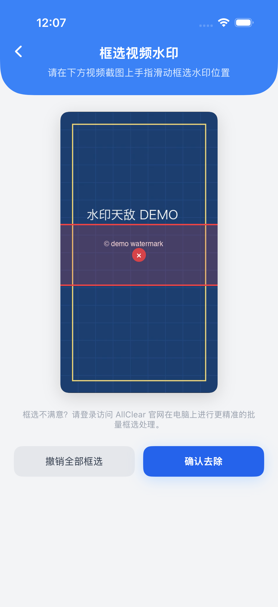

<div align="center">

# AllClear · 水印天敌

**一个应用，免费去除图片 / 视频 / 文档等常用素材的水印**

Android（Kotlin + Jetpack Compose）· iOS（SwiftUI）双端原生客户端

[功能](#功能对照) · [截图](#截图) · [快速开始](#快速开始) · [架构](#架构)

</div>

---

## 这是什么

AllClear（水印天敌）是一个多端去水印工具：选择图片、视频或文档，上传到云端完成 AI 去水印，几秒后下载结果并保存到相册 / 文件。

本仓库开源的是**两套原生客户端**，它们共用同一套后端 API：

| 平台 | 语言 / UI 框架 | 说明 |
| --- | --- | --- |
| Android | Kotlin 2.2 + Jetpack Compose (Material 3) | 已上架 |
| iOS | Swift 5.9 + SwiftUI（iOS 17+） | 已在模拟器完成端到端验收 |

> 服务端（FastAPI + 去水印算法）与鸿蒙、小程序版本不在本仓库内。客户端是薄壳，算力与计费都在后端。

**在线体验（国内可直接访问）：<https://allclearwatermark.com>**

## 截图

<p align="center">
  
  
  
  
</p>

<p align="center"><sub>iOS 版实机截图（Android 版界面语言一致）</sub></p>

## 功能对照

| 功能 | Android | iOS |
| --- | :---: | :---: |
| 相册多选图片、批量并发处理 | ✅ | ✅ |
| 视频去水印 | ✅ 直传后端自动检测 | ✅ 手动画框指定区域 |
| PDF / Word / PPT 文档去水印 | ✅ | ✅ |
| 文档「水印文字」提示词强化擦除 | ✅ | ✅ |
| AI 超强去水印开关 | ✅ | ✅ |
| 上传进度 / 批量处理进度 | ✅ | ✅ |
| 结果预览、保存相册、系统分享 | ✅ | ✅ |
| 邮箱登录 / 注册 | ✅ | ✅ |
| 每日签到领次数 | ✅ | ✅ |
| 头像与昵称修改 | — | ✅ |
| 扫码登录网页版 | — | ✅ |
| 充值 | ✅ 支付宝 / 微信扫码 | ✅ 一键跳转网页版充值（App 内 StoreKit 需自行配置 App Store 商品）|
| 首启隐私强确认、用户协议、隐私政策 | ✅ | ✅ |
| 新手教程、联系客服、邀请好友 | ✅ | ✅ |
| 账号注销 | ✅ | 🚧 |

## 技术栈

**Android**

- Kotlin 2.2.20 / AGP 8.13.2 / Gradle Version Catalog
- Jetpack Compose + Material 3，单 Activity、单 ViewModel
- OkHttp + 自定义 `RequestBody`：32 KB 缓冲边读边传，**全程不把文件读进内存**，同时回调上传进度
- Coil（图片）、ZXing（二维码本地生成，不联网）
- MediaStore 事务式写入（`IS_PENDING`），兼容 Android 10 前后两套存储模型
- minSdk 24 / targetSdk 36 / compileSdk 36

**iOS**

- SwiftUI，minimum iOS 17.0，无任何第三方依赖
- `URLSession` + 手写 multipart：先落临时文件再 `upload(fromFile:)`，大视频不占内存
- `PhotosPicker`（图片 / 视频）、`fileImporter`（文档）、AVKit（视频预览与框选）
- StoreKit 2 内购（符合 App Store 审核指南 3.1.1）
- XcodeGen 描述工程（`project.yml`）+ 单测 / UI 测试 target

## 快速开始

### Android

环境：JDK 17+、Android SDK Platform 36。**仓库已内置 Gradle Wrapper，clone 下来直接就能编。**

```bash
cd Android
./gradlew :app:assembleDebug        # macOS / Linux
gradlew.bat :app:assembleDebug      # Windows
```

产物：`Android/app/build/outputs/apk/debug/app-debug.apk`，**可直接安装到手机**（调试签名）。

也可以直接下载 Release 里的安装包，或点官网右上角「客户端下载」。

切换后端地址：

```bash
./gradlew :app:assembleDebug -PapiBase=http://10.0.2.2:8000/api
```

### iOS

环境：macOS + Xcode 15 以上（模拟器构建**不需要** Apple 开发者账号）。

```bash
cd iOS
open AllClear.xcodeproj          # 仓库已提交工程文件，可直接打开
```

若安装了 [XcodeGen](https://github.com/yonaskolb/XcodeGen)，修改 `project.yml` 或新增文件后重新生成：

```bash
brew install xcodegen && xcodegen generate
```

命令行一键编译 + 起模拟器 + 截图：

```bash
bash iOS/scripts/run_sim.sh              # 自动挑一台可用 iPhone 模拟器
bash iOS/scripts/run_sim.sh "iPhone 17 Pro"
```

切换后端地址：改 `iOS/AllClear/Services/APIClient.swift` 里的 `baseURL`，
或启动时用 `-apiBaseURL http://127.0.0.1:8000/api` 覆盖。

## 架构

```
┌─────────────┐   ┌─────────────┐
│   Android   │   │     iOS     │
│  Compose    │   │   SwiftUI   │
└──────┬──────┘   └──────┬──────┘
       │                 │
       └───────┬─────────┘
               ▼
    ┌──────────────────────┐
    │  FastAPI 后端（闭源） │
    │  鉴权 / 扣次 / 算法    │
    └──────────────────────┘
```

两端结构一致：**无状态 UI → 单一状态中枢 → 数据层**，单向数据流。

- Android 分层、关键实现与已知不足：[`Android/架构说明.md`](Android/架构说明.md)
- iOS 页面结构、接口对照与内购说明：[`iOS/README.md`](iOS/README.md)

## 常见问题

**Q：后端为什么不开源？**
算法与算力调度是产品的核心成本。仓库只含客户端，接口契约在
`Android/.../data/Api.kt` 与 `iOS/AllClear/Services/APIClient.swift` 中完整可见，可据此自行实现服务端。

**Q：编译后能直接用吗？**
可以，客户端默认连线上服务，注册即送体验次数。请勿用脚本批量注册——服务端有 IP 频率限制。

**Q：iOS 为什么同时提交了 `project.yml` 和 `.xcodeproj`？**
`.xcodeproj` 是二进制化的文本，多人协作时冲突几乎无法合并。`project.yml` 是可读、可 diff 的工程描述，
执行 `xcodegen generate` 即可重建工程；提交 `.xcodeproj` 只是为了让没装 XcodeGen 的人也能直接打开。

## 免责声明

本项目仅用于**处理你拥有合法权利或已获授权**的素材。请勿用于去除他人享有著作权的作品上的保护性水印并用于商业牟利。因使用本软件产生的任何版权纠纷与法律责任，由使用者自行承担。

## License

[MIT](LICENSE) © 2026 马鞍山市雨山区悟用网络科技工作室

> 代码以 MIT 协议开源，但**不授予「AllClear」「水印天敌」名称与标识的商标使用权**。二次分发请使用自己的应用名与图标。

---

**官网 / 在线体验：<https://allclearwatermark.com>**
