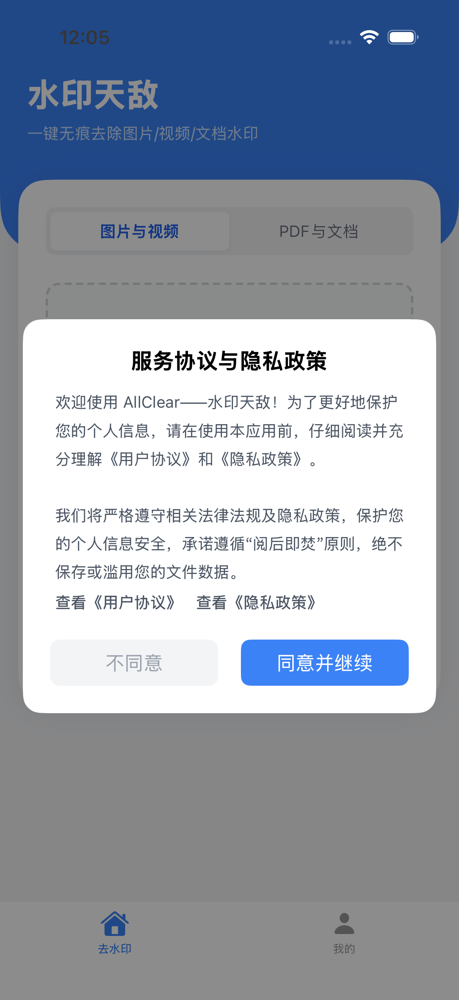
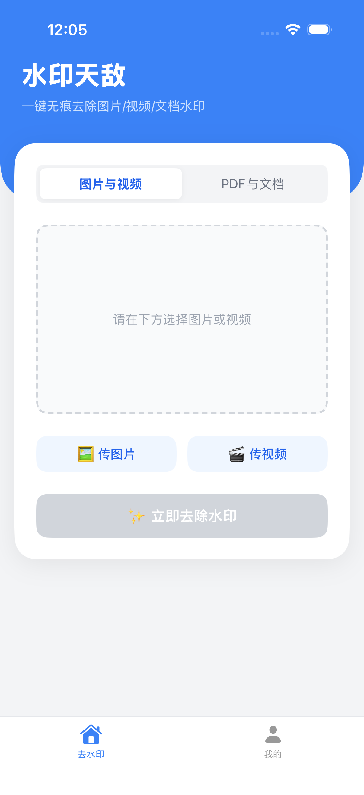
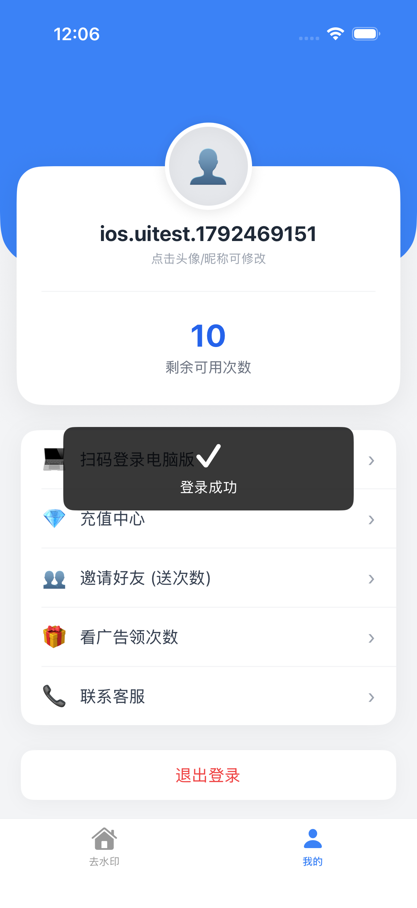
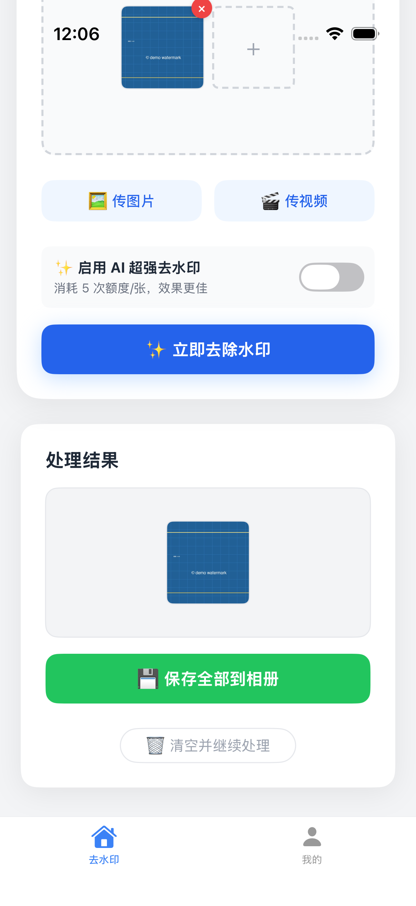
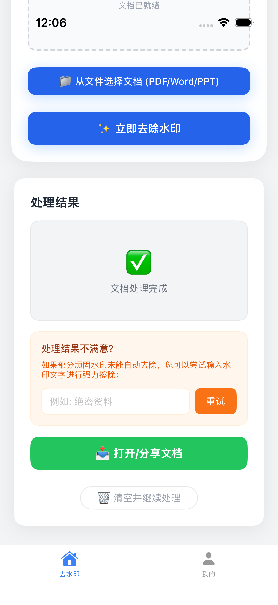
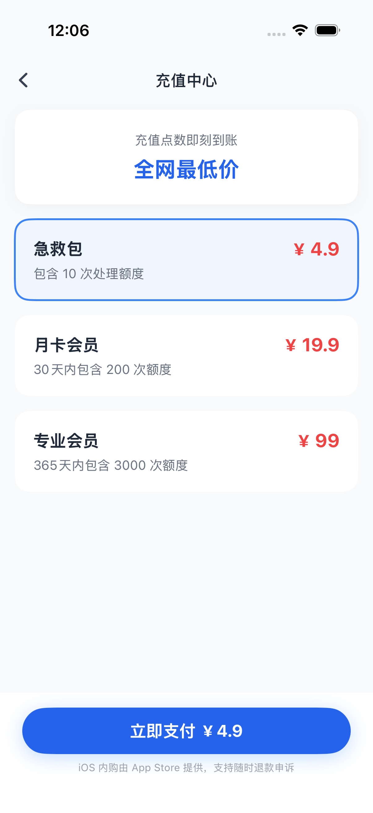
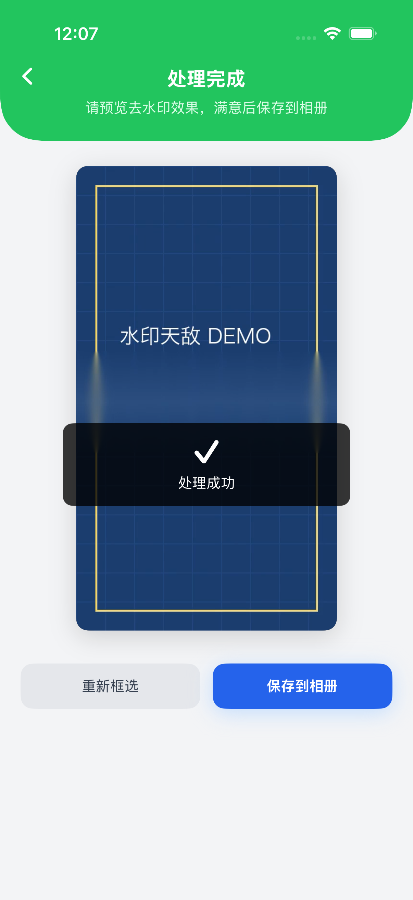
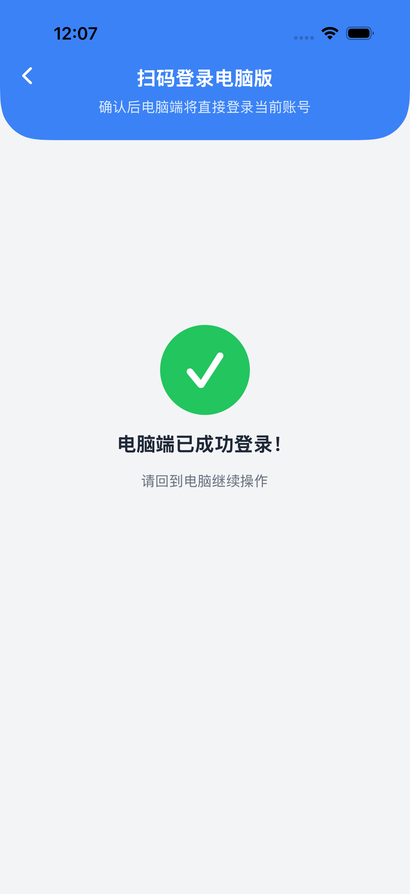

# AllClear iOS 原生版（水印天敌）

> 面试/技术栈/技术文案整理见 [iOS_Interview_Guide.md](iOS_Interview_Guide.md)。

本目录是「水印天敌」的 iOS 原生实现（SwiftUI），页面结构、交互流程、接口字段与鸿蒙端（Taro 编译产物 `harmony/`，源码 `miniprogram/src/`）对齐。

- 运行环境：Xcode 26.6 / iOS 26.5 模拟器（iPhone 17 Pro）
- 最低版本：iOS 17.0
- Bundle ID：`com.wuyong.allclear`
- 已在本机模拟器完成端到端验收：登录/注册、图片去水印、PDF 去水印、文档分享、视频框选与处理、保存相册、扫码登录电脑版。

## 快速运行

```bash
cd ios

# 修改 project.yml / 新增文件后重新生成工程（项目已生成，可直接跳过）
xcodegen generate

# 命令行构建
xcodebuild -project AllClear.xcodeproj -scheme AllClear \
  -sdk iphonesimulator \
  -destination 'platform=iOS Simulator,name=iPhone 17 Pro' \
  -derivedDataPath build build

# 安装并启动
xcrun simctl boot "iPhone 17 Pro" 2>/dev/null || true
xcrun simctl install booted build/Build/Products/Debug-iphonesimulator/AllClear.app
xcrun simctl launch booted com.wuyong.allclear
```

也可以直接双击 `AllClear.xcodeproj`，选择 `AllClear` Scheme 与 iPhone 模拟器后 Run。

### StoreKit（充值页）

`AllClear.storekit` 已加入 Scheme 的 Run → Options → StoreKit Configuration。
商品 ID：

| 商品 | Product ID | 类型 | 鸿蒙端对应 |
| --- | --- | --- | --- |
| 急救包 10 次 | `com.wuyong.allclear.pack_10` | Consumable | `pack_10` |
| 月卡会员 200 次 | `com.wuyong.allclear.pro_monthly` | Consumable | `pro_monthly` |
| 专业会员 3000 次 | `com.wuyong.allclear.pro_yearly` | Consumable | `pro_yearly` |

> iOS 26.5 模拟器存在已知问题：通过 `xcodebuild test` / `simctl launch` 启动时不会注入 Scheme 的 StoreKit 配置。请用 Xcode 的 Run 按钮验证商品加载与本地购买流程。
> 正式内购还需要 App Store Connect 商品与后端 `/api/orders/apple-iap` 发货接口；当前线上后端还没有该接口，App 会给出明确提示，不会静默扣款。

## 页面与鸿蒙端对照

| 鸿蒙端页面 | iOS 实现 | 对齐情况 |
| --- | --- | --- |
| `pages/index/index.tsx` 去水印 | `Views/RemoveWatermarkView.swift` | 蓝色圆角头图、白色浮层卡片、图片/视频与 PDF/文档切换、虚线预览区、9 图上限、图片删除/预览、AI 开关、扣费确认、批量进度、文档文字重试、结果网格、保存全部、清空 |
| `pages/video-edit/index.tsx` 视频框选 | `Views/VideoEditView.swift` | 视频循环预览、手指拖拽框选、红框删除、撤销全部、确认去除、处理完成预览、重新框选、保存相册 |
| `pages/profile/index.tsx` 我的 | `Views/MineView.swift` | 蓝色背景 + 浮层用户卡、头像/昵称修改、PRO 标识、剩余次数、操作教程（iOS 额外入口，居中卡片弹窗）、扫码登录电脑版、充值中心/获取额度、邀请好友、联系客服、退出登录、邮箱登录/注册弹窗 |
| `pages/recharge/index.tsx` 充值中心 | `Views/RechargeView.swift` | 审核模式维护页、三档套餐、选中高亮、底部支付按钮；App 内走 StoreKit，商品不可用时一键跳转网页版充值 |
| `app.config.ts` tabBar | `Views/RootView.swift` + `Components.swift` | 自定义底部 TabBar（去水印 / 我的），白底、顶部细线、蓝色选中态 |
| 隐私/协议 | `PrivacyConsentView.swift` / `LegalView.swift` | 保留 iOS 首启隐私同意与用户协议/隐私政策 |

### 与鸿蒙端一致的接口

去水印统一走鸿蒙端的**单文件接口**（不再使用旧的 batch 接口）：

- `POST /api/remove-image-watermark`：`file`、`regions=[]`、`use_ai=true/false`、`client=miniprogram`
- `POST /api/remove-video-watermark`：`file`、`regions=[{x,y,width,height}]`、`client=miniprogram`
- `POST /api/remove-pdf-watermark` / `remove-docx-watermark` / `remove-pptx-watermark`：`file`、`client=miniprogram`、可选 `prompt`
- `Authorization: Bearer <token>`
- 返回 `result_url`，客户端兼容 `result_url / output_url / url`

账号与配置：

- `POST /api/login`（form-urlencoded）、`POST /api/register`（JSON）
- `GET /api/users/me`、`PUT /api/users/me`（`nickName`）
- `POST /api/users/avatar`（multipart `file`）
- `GET /api/system/config`（`in_review`）
- `POST /api/auth/scan/confirm`（`scene_id`）

## 与鸿蒙端的 iOS 适配差异

以下差异是平台能力导致的必要适配，交互目标保持一致：

1. **登录方式**：鸿蒙端用微信一键授权；iOS 无法直接复用微信小程序登录，改为邮箱 + 密码登录/注册（后端 `/api/login`、`/api/register` 与鸿蒙端完全一致）。登录弹窗、注册切换、错误提示与鸿蒙端一致。
2. **分享**：鸿蒙端用微信转发；iOS 使用系统 `UIActivityViewController` 分享邀请链接。
3. **支付**：鸿蒙端用微信/华为 IAP；iOS 使用 StoreKit 2（消耗型），后端待补 Apple 验签接口。
4. **选文件**：鸿蒙端 `chooseMessageFile` 从微信聊天记录选文档；iOS 使用系统「文件」选择器（PDF/Word/PPT）。
5. **扫码**：iOS 同时支持相机扫码与「从相册选择二维码」，模拟器无摄像头时自动回落到相册。

## 测试

工程包含 1 个单元测试与 7 个 UI 测试：

```bash
cd ios
xcodebuild -project AllClear.xcodeproj -scheme AllClear \
  -sdk iphonesimulator \
  -destination 'platform=iOS Simulator,name=iPhone 17 Pro' \
  -derivedDataPath build test
```

覆盖：

- 首启 Splash / 隐私弹窗 / 同意进入主界面
- 主界面、我的、登录/注册弹窗
- 注册 → 登录 → 选图 → 扣费确认 → 去水印 → 结果展示 → 保存相册
- 充值中心页面
- PDF 选择 → 去水印 → 结果 → 下载并拉起系统分享面板
- 视频框选 → 确认去除 → 结果预览 → 保存相册
- 扫码登录电脑版 → `/auth/scan/confirm` 成功页
- StoreKit 配置文件结构校验

> 相册保存相关的 UI 测试首次运行需要授予「添加照片」权限；可在模拟器执行：
> `xcrun simctl privacy booted grant photos-add com.wuyong.allclear`

### DEBUG 验收参数

仅 Debug 有效，用于模拟器快速验收：

| 参数 | 作用 |
| --- | --- |
| `-skipOnboarding` | 跳过首启隐私弹窗与 Splash |
| `-resetOnboarding` | 重新展示首启隐私弹窗 |
| `-resetSession` | 清空本地登录态 |
| `-startTab mine` | 启动后进入「我的」 |
| `-openRecharge` | 启动后直接打开充值中心 |
| `-openTutorial` | 启动后直接打开操作教程 |
| `-autoLogin <email> <password>` | 启动时自动登录（仅 Debug，便于模拟器验收） |
| `-demoImage` | 预置一张带水印示例图 |
| `-demoDocument` | 预置一份带水印示例 PDF |
| `-demoVideo` | 直接进入视频框选页 |
| `-demoScanQR allclear_login:<scene>` | 模拟扫码成功（联调 `/auth/scan/confirm`） |

## 目录结构

```
ios/
├── AllClear.xcodeproj          # XcodeGen 生成
├── AllClear.storekit           # StoreKit 本地测试配置
├── project.yml                 # XcodeGen 工程定义
├── AllClear/
│   ├── AllClearApp.swift
│   ├── Models/Models.swift
│   ├── Services/
│   │   ├── APIClient.swift     # 与鸿蒙端字段一致的单文件接口
│   │   ├── Session.swift       # 登录态 / 用户信息
│   │   ├── Uploader.swift      # multipart 上传 + 进度
│   │   ├── MediaSaver.swift    # 下载 / 保存相册
│   │   ├── StoreManager.swift  # StoreKit 2
│   │   └── Toast.swift         # Toast / Loading
│   ├── Views/
│   │   ├── RootView.swift      # 自定义 TabBar + 导航
│   │   ├── RemoveWatermarkView.swift
│   │   ├── VideoEditView.swift
│   │   ├── MineView.swift
│   │   ├── LoginSheet.swift    # LoginModalView
│   │   ├── RechargeView.swift
│   │   ├── ScanLoginView.swift
│   │   ├── Components.swift
│   │   ├── Theme.swift
│   │   ├── SplashView.swift
│   │   ├── PrivacyConsentView.swift
│   │   ├── LegalView.swift
│   │   └── TutorialView.swift
│   ├── Resources/              # 演示图 / PDF / 视频（DEBUG 验收用）
│   └── Assets.xcassets         # AppIcon
├── AllClearTests/              # StoreKit 配置结构校验
├── AllClearUITests/            # UI 端到端测试
└── Screenshots/                # 模拟器验收截图
```

## 验收截图

| 首启隐私 | 主界面 | 我的（已登录） |
| --- | --- | --- |
|  |  |  |

| 图片处理结果 | PDF 处理结果 | 充值中心 |
| --- | --- | --- |
|  |  |  |

| 视频框选 | 视频处理结果 | 扫码登录成功 |
| --- | --- | --- |
|  |  |  |

更多截图见 `Screenshots/`：

- `03-profile-guest.png`、`04-login.png`
- `06-image-selected.png`、`07-charge-confirm.png`、`09-image-saved.png`
- `11-document-selected.png`、`13-document-share.png`
- `14-video-select.png`、`17-video-saved.png`、`18-scan.png`
- `20-profile-tutorial-entry.png`、`21-tutorial.png`（操作教程入口与教程页）
- `22-profile-logged-in-demo.png`（已登录演示账号）

## 已知待办（发布前）

- 后端新增 `/api/orders/apple-iap`（App Store Server API 验签 + 幂等发货），与鸿蒙端 `/api/orders/huawei-iap` 对齐。
- 在 App Store Connect 创建上述 3 个消耗型商品，替换 `AllClear.storekit` 中的占位价格。
- 正式上架前按 App Store 要求补充 Apple 登录（如需）、隐私清单与 App 隐私标签。
